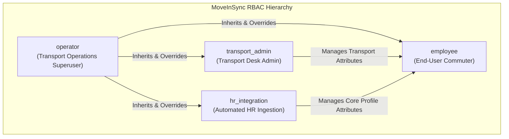

# Role-Based Access Control (RBAC) & Domain Field Ownership Specification

**Project:** MoveInSync HR Roster Sync  
**Document:** `ROLES.md`  
**Architecture:** Multi-Tenant Enterprise Commute Platform  
**Target Audience:** Backend Engineers, Security Auditors, DevOps, and Integration Partners  

---

## 1. Executive Summary

MoveInSync coordinates daily corporate commutes across tens of thousands of employees. Security and operational safety require strict boundaries between:
1. **Automated HR Data Feeds** (external systems such as Workday, SAP SuccessFactors, or BambooHR).
2. **Corporate Transport Desk Operations** (internal transport dispatchers managing cab routing, geofences, and special assistance).
3. **Emergency Operations Superusers** (shift supervisors authorized to override safety brakes and manage dead-letter queues).
4. **Commuting Employees** (individual workers accessing personal roster and transport details).

To enforce this, the platform combines **Tenant Scoping**, **Role-Based Access Control (RBAC)** via cryptographic JWT claims / API Keys, and **Domain Field Ownership** at the database layer.

---

## 2. Core Roles Definition

The platform defines **4 distinct roles**:



### 1. `hr_integration` (Automated HR System)
* **Identity:** Machine-to-machine integration caller (Workday, SuccessFactors, nightly ETL pipeline).
* **Scope:** Push near-real-time employee lifecycle events (new hires, office transfers, terminations) and upload full nightly CSV roster snapshots (up to 200,000 records).
* **Guarantees:**
  * Cannot alter transport-specific routing attributes (`preferred_pickup_point_id`, `pickup_geofence`, `special_assistance_required`).
  * Cannot trigger manual outbox republishes or flush Dead Letter Queues (DLQ).
  * Cannot override safety brake triggers when mass deactivations are halted.

### 2. `transport_admin` (Corporate Transport Desk Administrator)
* **Identity:** Human transport operations administrator or corporate fleet coordinator.
* **Scope:** Configures and maintains employee commute parameters.
* **Guarantees:**
  * Exclusive write authority over transport-owned fields: pickup geofences, designated pickup points, shift timings, and medical/special assistance requirements.
  * Cannot overwrite HR-owned attributes (such as official employee names, email addresses, or manager hierarchy).
  * Can inspect reconciliation drift reports to assess workforce movements across office campuses.

### 3. `operator` (Operations Superuser & Safety Brake Controller)
* **Identity:** Senior transport operations supervisor or system reliability engineer.
* **Scope:** Operational recovery, emergency interventions, audit inspection, and incident management.
* **Superuser Capabilities:**
  * **Inheritance:** As implemented in `AuthContext.has_role()`, any security guard requiring `hr_integration` or `transport_admin` automatically permits the `operator` role.
  * **Safety Brake Override:** Sole role authorized to review, approve (`POST /approve`), or abort (`POST /abort`) halted reconciliation runs when missing active workforce exceeds the 30% safety brake threshold.
  * **Dead Letter Queue (DLQ) Management:** Authority to inspect outbox publication failures (`GET /api/v1/outbox/status`) and trigger bulk retries (`POST /api/v1/outbox/retry-dlq`).

### 4. `employee` (Corporate Commuter)
* **Identity:** Individual corporate employee accessing the MoveInSync mobile application or web portal.
* **Scope:** Strictly read-only self-service access.
* **Guarantees:**
  * Enforced self-scoping: When authenticated as a pure `employee`, the endpoint verifies that `auth.user_id == employee_id`. Attempting to access another employee's record immediately yields `403 Forbidden`.

---

## 3. Domain Field Ownership Boundaries

A common failure mode in enterprise roster integration is **uncontrolled field overwrites** (e.g., an automated HR nightly sync wiping out a custom pickup point assigned by transport desk). MoveInSync enforces **strict field segregation**:

| Field Name | Owning Role | Description | Mutation Rule |
| :--- | :---: | :--- | :--- |
| `employee_id` | **System / HR** | Unique employee identifier within tenant. | Immutable after creation. |
| `first_name` | `hr_integration` | Employee legal given name. | Updated only by HR feeds. |
| `last_name` | `hr_integration` | Employee legal surname. | Updated only by HR feeds. |
| `email` | `hr_integration` | Corporate corporate email (RFC 5322). | Updated only by HR feeds. |
| `phone` | `hr_integration` | Primary contact number (E.164 format). | Updated only by HR feeds. |
| `office_code` | `hr_integration` | Assigned corporate office / facility campus. | Triggers transport safety review on change. |
| `department` | `hr_integration` | Organizational unit / business division. | Updated only by HR feeds. |
| `manager_id` | `hr_integration` | Supervisor employee ID. | Updated only by HR feeds. |
| `status` | `hr_integration` | Employment status (`ACTIVE` / `INACTIVE`). | Transition to `INACTIVE` cancels downstream bookings. |
| `source_version` | `hr_integration` | Monotonically increasing version counter. | Prevents out-of-order stale overwrites. |
| `preferred_pickup_point_id` | `transport_admin` | Designated cab boarding landmark or node ID. | **Protected from HR overwrites.** |
| `pickup_geofence` | `transport_admin` | GeoJSON polygon or coordinate bounding box. | **Protected from HR overwrites.** |
| `special_assistance_required` | `transport_admin` | Accessibility / disability commute flag. | **Protected from HR overwrites.** |
| `transport_review_required` | **System-Generated** | Workflow flag for transport coordinator review. | Set to `true` when office changes with active pickup point. |
| `record_hash` | **System-Generated** | xxHash64 / Canonical SHA-256 fingerprint. | Computed automatically on payload mutation. |

### Office Relocation Workflow (`transport_review_required`)
When an HR event updates an employee's `office_code`:
1. If the employee already has a configured `preferred_pickup_point_id` or `pickup_geofence` for their old office, the system **does not** delete the commute configuration.
2. Instead, the service automatically sets `transport_review_required = True`.
3. The transport desk is alerted to review and reassign a valid pickup point for the new campus, ensuring the employee's commute is never silently disrupted.

---

## 4. API Endpoints & Role Access Matrix

All requests require either a valid JWT Bearer Token in the `Authorization` header or a valid API Key in the `X-API-Key` header.

| Endpoint | HTTP Method | Permitted Roles | Description | Failure Code |
| :--- | :---: | :--- | :--- | :---: |
| `/api/v1/auth/token` | `POST` | *Public* | Exchange Client Credentials for signed JWT token. | `401 Unauthorized` |
| `/api/v1/roster/events` | `POST` | `hr_integration`, `operator` | Ingest real-time HR events (batch size $\le 500$). | `403 Forbidden` |
| `/api/v1/reconciliation/upload` | `POST` | `hr_integration`, `operator` | Stream full nightly CSV export file (up to 200,000 rows). | `403 Forbidden` |
| `/api/v1/reconciliation/{run_id}/report` | `GET` | `operator`, `transport_admin`, `hr_integration` | View safety brake anomaly summary and sample missing IDs. | `403 Forbidden` |
| `/api/v1/reconciliation/{run_id}/approve` | `POST` | `operator` | Authorize bulk deactivations after safety brake trigger. | `403 Forbidden` |
| `/api/v1/reconciliation/{run_id}/abort` | `POST` | `operator` | Abort a halted reconciliation run (cancels all deactivations). | `403 Forbidden` |
| `/api/v1/transport/employees/{emp_id}` | `PUT` | `transport_admin`, `operator` | Update commute routing, pickup point, and assistance. | `403 Forbidden` |
| `/api/v1/employees/{emp_id}` | `GET` | `employee`, `transport_admin`, `operator`, `hr_integration` | View complete employee profile and commute metadata. | `403 Forbidden` |
| `/api/v1/outbox/status` | `GET` | `operator` | Inspect pending, dead-letter (DLQ), and published events. | `403 Forbidden` |
| `/api/v1/outbox/retry-dlq` | `POST` | `operator` | Replay dead-lettered downstream cancellation events. | `403 Forbidden` |
| `/healthz` | `GET` | *Public* | Kubernetes liveness probe. | None |
| `/readyz` | `GET` | *Public* | Kubernetes readiness probe (validates DB connectivity). | `503 Service Unavailable` |
| `/metrics` | `GET` | *Internal / Prometheus* | System throughput, drift, and safety brake counters. | None |

---

## 5. Authentication & Security Architecture

### A. JWT Token Issuance (`POST /api/v1/auth/token`)
* **Algorithm:** HMAC-SHA256 (`HS256`)
* **Token Lifetime:** 60 minutes
* **Claims Payload:**
  ```json
  {
    "sub": "client-id-or-user-id",
    "tenant_id": "tenant-alpha",
    "roles": ["hr_integration"],
    "iat": 1793375000,
    "exp": 1793378600
  }
  ```
* **Tenant Isolation:** The `tenant_id` claim is extracted directly from the verified token signature. SQL queries across all repositories strictly filter by `WHERE tenant_id = :tenant_id`, guaranteeing cross-tenant data isolation.

### B. Programmatic API Key Header (`X-API-Key`)
* Programmatic background workers can authenticate by passing an API key in the `X-API-Key` HTTP header.
* API keys are hashed with SHA-256 and compared using constant-time digest comparison (`hmac.compare_digest`) to prevent timing attacks.

---

## 6. Pre-Configured Test Credentials

The following credentials are pre-configured in `app/core/auth.py` for testing and evaluation:

### 1. Client Credentials (Token Login)

| Tenant | Client ID | Client Secret | Assigned Roles | Recommended Use Case |
| :--- | :--- | :--- | :--- | :--- |
| `tenant-alpha` | `hr-service` | `hr-client-secret-alpha-2026` | `["hr_integration"]` | Real-time event & CSV ingestion testing |
| `tenant-alpha` | `transport-admin` | `transport-admin-secret-alpha-2026` | `["transport_admin"]` | Pickup point & geofence configuration |
| `tenant-alpha` | `operator-service` | `operator-secret-alpha-2026` | `["operator", "transport_admin", "hr_integration"]` | Full superuser, approval & DLQ operations |
| `tenant-beta` | `hr-service` | `hr-client-secret-beta-2026` | `["hr_integration"]` | Multi-tenant isolation testing |
| `tenant-beta` | `operator-service` | `operator-secret-beta-2026` | `["operator", "transport_admin", "hr_integration"]` | Tenant-Beta superuser testing |

### 2. Pre-Configured API Keys (`X-API-Key`)

| Tenant | API Key | Assigned Roles |
| :--- | :--- | :--- |
| `tenant-alpha` | `alpha-hr-api-key-secure-999` | `["hr_integration"]` |
| `tenant-alpha` | `alpha-operator-api-key-secure-888` | `["operator", "transport_admin", "hr_integration"]` |

---

## 7. Practical Usage Examples

### 1. Authenticate and Obtain JWT Token
```bash
curl -X POST http://localhost:8000/api/v1/auth/token \
  -H "Content-Type: application/json" \
  -d '{
    "tenant_id": "tenant-alpha",
    "client_id": "operator-service",
    "client_secret": "operator-secret-alpha-2026"
  }'
```

*Response:*
```json
{
  "access_token": "eyJhbGciOiJIUzI1NiIsIn...",
  "token_type": "bearer",
  "expires_in_minutes": 60,
  "tenant_id": "tenant-alpha",
  "roles": ["operator", "transport_admin", "hr_integration"]
}
```

### 2. Ingest HR Event using JWT Token (`hr_integration` or `operator`)
```bash
curl -X POST http://localhost:8000/api/v1/roster/events \
  -H "Authorization: Bearer <TOKEN>" \
  -H "Content-Type: application/json" \
  -H "X-Idempotency-Key: idemp-evt-101" \
  -d '{
    "events": [
      {
        "event_id": "evt-001",
        "employee_id": "EMP-001",
        "first_name": "Arun",
        "last_name": "Kumar",
        "email": "arun.kumar@company.com",
        "phone": "+919876543210",
        "office_code": "BLR-CAMPUS-1",
        "status": "ACTIVE",
        "source_version": 1
      }
    ]
  }'
```

### 3. Update Transport Route as Transport Admin (`transport_admin`)
```bash
curl -X PUT http://localhost:8000/api/v1/transport/employees/EMP-001 \
  -H "Authorization: Bearer <TOKEN>" \
  -H "Content-Type: application/json" \
  -d '{
    "preferred_pickup_point_id": "NODE-BLR-042",
    "pickup_geofence": {
      "type": "Polygon",
      "coordinates": [[[77.59, 12.97], [77.60, 12.97], [77.60, 12.98], [77.59, 12.97]]]
    },
    "special_assistance_required": true
  }'
```

### 4. Overriding the Safety Brake (`operator` only)
When a truncated nightly CSV sync triggers the 30% Safety Brake (`SAFETY_BRAKE_TRIGGERED`):
```bash
curl -X POST http://localhost:8000/api/v1/reconciliation/recon-tenant-alpha-1234/approve \
  -H "Authorization: Bearer <OPERATOR_TOKEN>" \
  -H "Content-Type: application/json" \
  -d '{
    "operator_id": "lead-supervisor-01",
    "reason": "Authorized corporate office consolidation mass exit"
  }'
```

---

## 8. Summary Checklist for Developers & Operators

- [x] **Zero Trust Default:** All routes require authentication except `/healthz`, `/readyz`, `/metrics`, and `/api/v1/auth/token`.
- [x] **Field Boundaries:** Never accept transport attributes in HR event schemas; never accept HR employment attributes in transport schemas.
- [x] **Tenant Scoping:** Always verify that the caller's JWT `tenant_id` matches the path/database target.
- [x] **Safety Brake Protection:** Only `operator` can unblock mass deactivations.
- [x] **Self-Service Restriction:** Ensure pure `employee` users cannot view co-workers' profiles or travel manifests.
