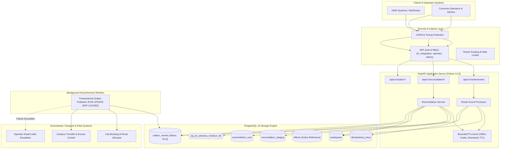
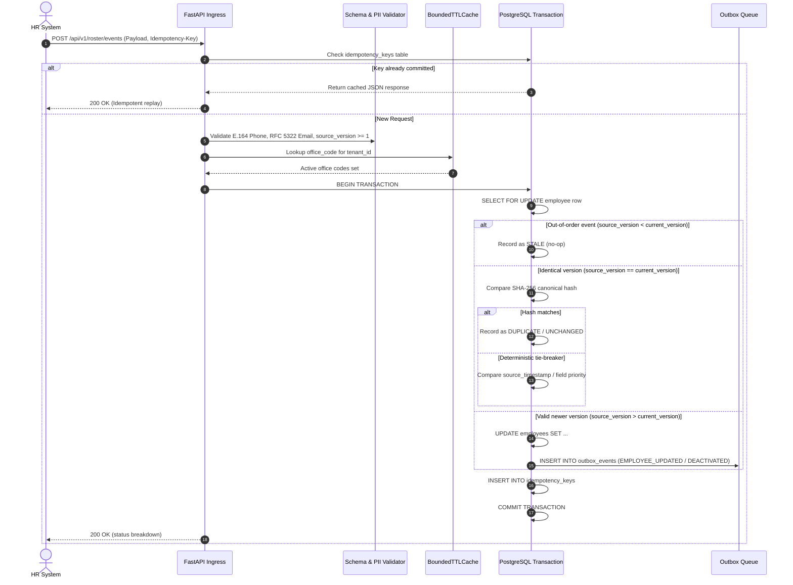
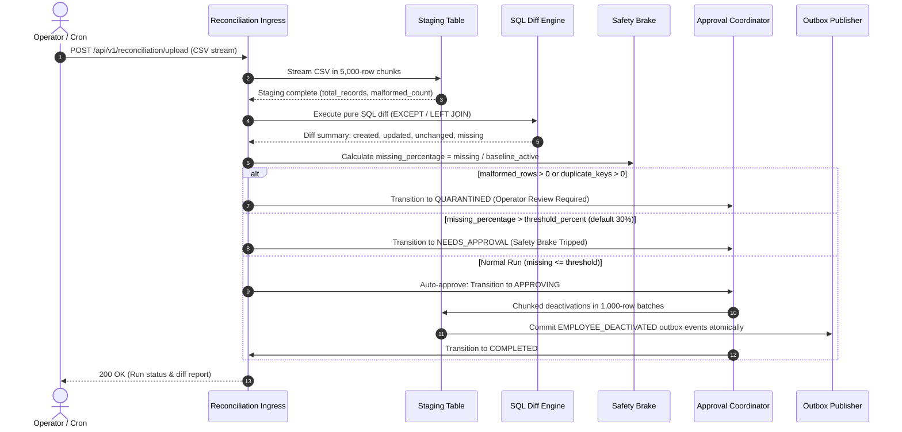
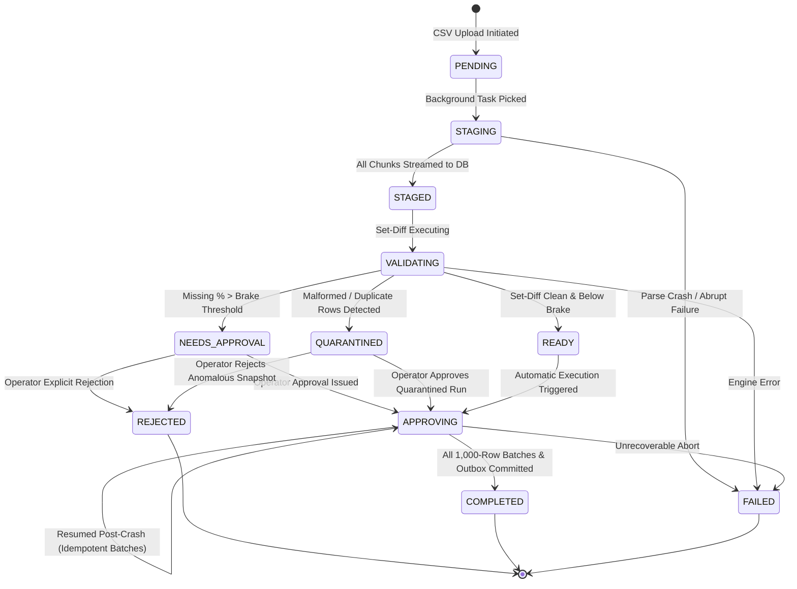

# MoveInSync HR Roster Sync — System Architecture

## 1. Executive Architecture Overview

MoveInSync HR Roster Sync is an enterprise-grade distributed synchronization engine engineered for **Case Study 5: Idempotent, Out-of-Order, Self-Healing HR Roster Sync**.

The platform reconciles human resource employee rosters with enterprise commute, cab-routing, and security infrastructure across two synchronized ingress vectors:
1. **Live Event Stream**: Real-time webhook and event updates (`CREATE`, `UPDATE`, `DEACTIVATE`, `OFFICE_TRANSFER`) arriving out-of-order, concurrently, or duplicated from upstream HRIS systems (Workday, SAP SuccessFactors, BambooHR).
2. **Nightly Full Snapshot Reconciliation**: Bulk CSV export snapshots (up to 200,000+ employees) uploaded nightly to detect missing joiners, stale departures, departmental shifts, and office transfers.

### Architectural Philosophy: Zero External Infrastructure Beyond PostgreSQL
Rather than introducing operational fragility and distributed transaction overhead through Kafka, Redis, RabbitMQ, or Celery, the system utilizes **PostgreSQL 16 as the single, authoritative state engine, transactional coordinator, and streaming buffer**:
- **Streaming Staging**: Chunked ingestion directly into unlogged staging tables avoiding resident memory inflation ($< 256$ MB RSS peak).
- **Set-Based Differential Calculus**: Pure relational SQL diffs (`EXCEPT`, `LEFT JOIN`) replacing $O(N)$ Python memory materialization.
- **Physical Session Pinned Advisory Locks**: `pg_try_advisory_lock` guaranteeing strictly mutually exclusive reconciliation approval workflows.
- **Transactional Outbox with `FOR UPDATE SKIP LOCKED`**: Zero-latency distributed publishing with queue depth tracking, exponential backoff, jitter, and dead-letter queue (DLQ) containment.

---

## 2. System Component Topology



---

## 3. End-to-End Data Flows

### A. Live Event Ingestion Data Flow
Real-time events arrive via `POST /api/v1/roster/events`. Each event passes through deterministic validation, version fencing, and transactional outbox emission:



### B. Nightly Snapshot Reconciliation Data Flow
Nightly CSV snapshots process up to 200,000+ employees in bounded memory chunks:



---

## 4. Reconciliation State Machine

The reconciliation lifecycle is governed by an explicit, durable, crash-resilient finite state machine:



---

## 5. Concurrency & Isolation Model

### 1. Tenant Partitioning
All operational tables (`employees`, `reconciliation_runs`, `reconciliation_staging`, `outbox_events`, `offices`, `idempotency_keys`) enforce strict `tenant_id` column partitioning. Foreign queries and cross-tenant mutations are impossible:
- All database queries filter explicitly by `WHERE tenant_id = :tenant_id`.
- Tenant context is authenticated and extracted cryptographically from verified JWT tokens.

### 2. Session-Level Pinned PostgreSQL Advisory Locks
To eliminate race conditions during approval of large reconciliations without long-lived blocking table locks:
```python
# Acquire advisory lock bound to dedicated physical PostgreSQL connection:
lock_id = hash(run_id) & 0x7FFFFFFF
acquired = await conn.execute(text(f"SELECT pg_try_advisory_lock({lock_id})"))
```
- **Connection Pinning**: The lock is tied to the physical asyncpg backend process (`bind=conn`).
- **Transaction Independence**: Individual 1,000-row deactivation batches can execute `COMMIT` and `ROLLBACK` repeatedly without releasing the advisory lock.
- **Fail-Safe Release**: The lock is released in a mandatory `finally` block or automatically discarded when the PostgreSQL backend connection terminates.

### 3. Worker Queue De-duplication (`FOR UPDATE SKIP LOCKED`)
Multiple concurrent Outbox Publisher workers poll the `outbox_events` table simultaneously:
```sql
SELECT * FROM outbox_events
WHERE status IN ('PENDING', 'FAILED') AND next_retry_at <= NOW()
ORDER BY created_at ASC
LIMIT :batch_size
FOR UPDATE SKIP LOCKED;
```
- Workers acquire row-level locks only on unallocated events.
- Concurrently active workers instantly skip locked rows and process completely disjoint subsets.
- Lock contention and deadlocks are mathematically eliminated.

---

## 6. Transaction Boundary Contracts

| Workflow | Boundary Scope | Commit Guarantees | Rollback Guarantees |
| :--- | :--- | :--- | :--- |
| **Live Event Ingestion** | Single Event Batch (up to 500 records) | Employee status + Outbox events + Idempotency key committed in single transaction. | Any unhandled exception rolls back all employee mutations and outbox events together. |
| **Snapshot Staging** | 5,000 CSV rows per chunk | Staged rows flushed to `reconciliation_staging` with run progress counter. | Chunk-level failure rolls back chunk; prior committed chunks remain durable. |
| **Approval Deactivation** | 1,000 missing employees per batch | Status update (`INACTIVE`), `deactivated_at`, and `EMPLOYEE_DEACTIVATED` outbox records committed in SAME transaction. | If outbox insert fails, employee status rolls back to `ACTIVE`. No orphaned deactivations. |
| **Outbox Dispatch** | Single Outbox Record | Downstream delivery acknowledged before marking `PUBLISHED` or scheduling retry. | Delivery failure records incremented `retry_count`, calculates exponential backoff + jitter, or escalates to `DEAD_LETTER`. |
