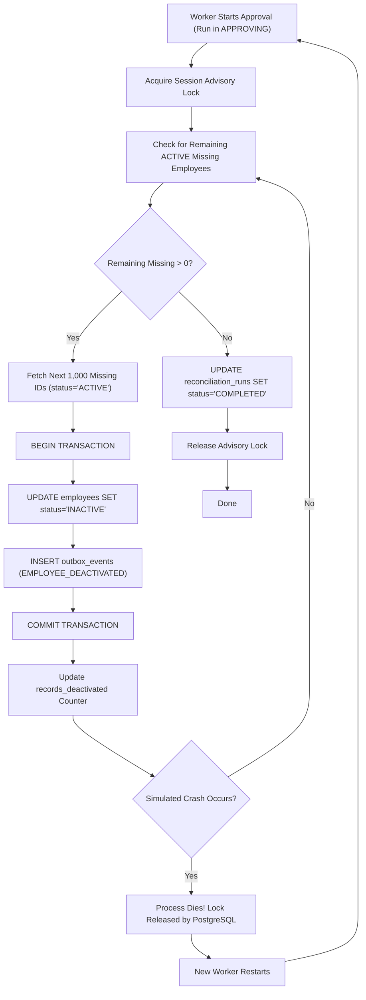

# MoveInSync HR Roster Sync — Failure Modes & Crash Recovery Protocols

## 1. Comprehensive System Failure Matrix

The following matrix documents every potential point of failure in the MoveInSync synchronization engine, its blast radius, and the automated recovery mechanism:

| Failure Scenario | Ingress / Worker Component | Immediate Symptom | Automated Recovery / Mitigation | Data Loss Risk |
| :--- | :--- | :--- | :--- | :--- |
| **Worker Crash during Staging** | Ingress CSV Stream | Staging ceases; run left in `STAGING`. | Run can be re-executed. Any uncommitted staging rows roll back cleanly via PostgreSQL transaction boundary. | **Zero** |
| **Outbox Insert Crash after Employee Mutation** | Approval / Delta Sync | Attempt to commit outbox fails after employee status change. | **Atomic Batch Transaction**: Both employee mutation and outbox record roll back in the same transaction. Employee remains `ACTIVE`. | **Zero** |
| **Crash Mid-Way Through Deactivation (Batch 4 of 10)** | Approval Worker | Process killed (`SIGKILL`, power failure). First 3 batches committed; 7 remain. | **Durable Checkpointing**: Batches 1–3 remain committed. Run remains `APPROVING`. Resumed worker queries `WHERE status = 'ACTIVE'`; cleanly processes batches 4–10 without repeating batches 1–3. | **Zero** |
| **Simultaneous Approval Requests** | Operator Web Ingress | Two operators or automated cron click "Approve" at the same millisecond. | **Physical Advisory Lock**: Worker 1 acquires `pg_try_advisory_lock`; Worker 2 gets `FALSE` and immediately receives `409 Conflict`. Zero duplicate work. | **Zero** |
| **Downstream Fleet 503 Service Unavailable** | Outbox Publisher | Downstream cab-booking API returns 503 or times out. | **Exponential Backoff with Jitter**: Event marked `FAILED`; `next_retry_at` monotonic advancement. Retried up to 5 times. | **Zero** |
| **Downstream Fleet Permanent Failure** | Outbox Publisher | Event fails 5 consecutive retries over 30 minutes. | **Dead-Letter Queue (DLQ)**: Event transitions to `DEAD_LETTER`. Operator alerted via Prometheus `OUTBOX_DLQ_TOTAL`. Can inspect and re-enqueue via API. | **Zero** |
| **Out-of-Order Webhook Delivery** | Live Ingress | Version 1 webhook arrives AFTER Version 3 webhook. | **Monotonic Version Fencing**: DB requires `incoming.source_version > current.source_version`. Version 1 discarded as `STALE`. | **Zero** |
| **Stale Snapshot Races with Live Event** | Nightly Recon vs Live | Nightly snapshot generated at 2 AM applies at 3 AM while 2:30 AM live event already updated employee. | **Row-Level Version Check**: Revalidation during delta sync skips staging records where `staging.source_version < employee.source_version`. | **Zero** |

---

## 2. Crash Recovery Protocols

### Protocol 1: Bounded Batch Deactivation Recovery

When deactivating a large volume of missing employees (e.g., 10,000 employees across 10 batches of 1,000):



#### Durability Invariant
- Every committed batch of 1,000 is permanent.
- Deactivated employees have `status = 'INACTIVE'`.
- If a crash occurs after committing batch $K$, the restarted worker's query:
  ```sql
  SELECT e.employee_id
  FROM employees e
  LEFT JOIN reconciliation_staging s ON e.employee_id = s.employee_id AND s.run_id = :run_id
  WHERE e.tenant_id = :tenant_id AND e.status = 'ACTIVE' AND s.employee_id IS NULL
  LIMIT 1000;
  ```
  will naturally skip the $K \times 1000$ employees already deactivated, processing batch $K+1$ immediately.

---

## 3. Transactional Outbox Retries & Dead-Letter Queue (DLQ)

The Outbox Publisher guarantees **at-least-once delivery** of all domain events to downstream fleet and security systems without introducing external message brokers.

### A. Exponential Backoff with Random Jitter
When a downstream service experiences transient failure (network timeout, HTTP 500/502/503), the event is rescheduled:
$$\text{Delay} = \left(2^{\text{retry\_count}} \times \text{base\_backoff}\right) + \text{jitter}$$

Where:
- $\text{base\_backoff} = 1.0\text{ seconds}$
- $\text{jitter} \sim \text{Uniform}(0.1, 0.5)\text{ seconds}$
- $\text{next\_retry\_at} = \text{NOW}() + \text{Delay}$

This formula prevents the "thundering herd" problem when downstream systems recover.

### B. DLQ Escalation
- **Max Retries Threshold**: Configurable via `settings.outbox_max_retries` (default: 5).
- Upon the 5th consecutive failure:
  1. The event status is transitioned to `DEAD_LETTER`.
  2. The final downstream error message is stored in `last_error`.
  3. Metric `OUTBOX_DLQ_TOTAL` is incremented.
  4. The worker logs an `ERROR` event with full tenant and event metadata.

### C. Operator DLQ Inspection & Replay API
Operators can safely inspect and replay dead-letter events through dedicated administrative endpoints:
- **List DLQ Events**:
  ```http
  GET /api/v1/outbox/dlq?limit=50
  Authorization: Bearer <operator_token>
  ```
- **Replay Single Event**:
  ```http
  POST /api/v1/outbox/dlq/{event_id}/retry
  Authorization: Bearer <operator_token>
  ```
  Re-enqueues the event immediately by setting `status = 'PENDING'`, `retry_count = 0`, and `next_retry_at = NOW()`.

---

## 4. Ingress Idempotency Guarantees

Upstream HR systems frequently resend webhooks on transient network disconnects. Duplicate delivery must never corrupt state or emit duplicate downstream events.

### A. Idempotency Key Workflow
1. HR caller provides `Idempotency-Key: <unique_uuid>` in request headers.
2. Ingress middleware computes SHA-256 hash of the request body.
3. Checks `idempotency_keys` table:
   - If key exists and `request_hash` matches: Returns the cached HTTP response directly from the database without re-executing any business logic.
   - If key exists but `request_hash` differs: Rejects with `422 Unprocessable Entity` (payload tampering protection).
4. If key is new: Executes event ingestion within a database transaction, inserts the idempotency record, and commits both atomically.

### B. Canonical Hash De-duplication
If an event arrives without an idempotency key (or with a different key) but contains identical employee data, the canonical hash:
$$\text{SHA-256}(f(\text{employee\_id}, \text{first\_name}, \dots, \text{status}))$$
matches the existing record. The engine marks the record as `UNCHANGED` and emits zero outbox events.
