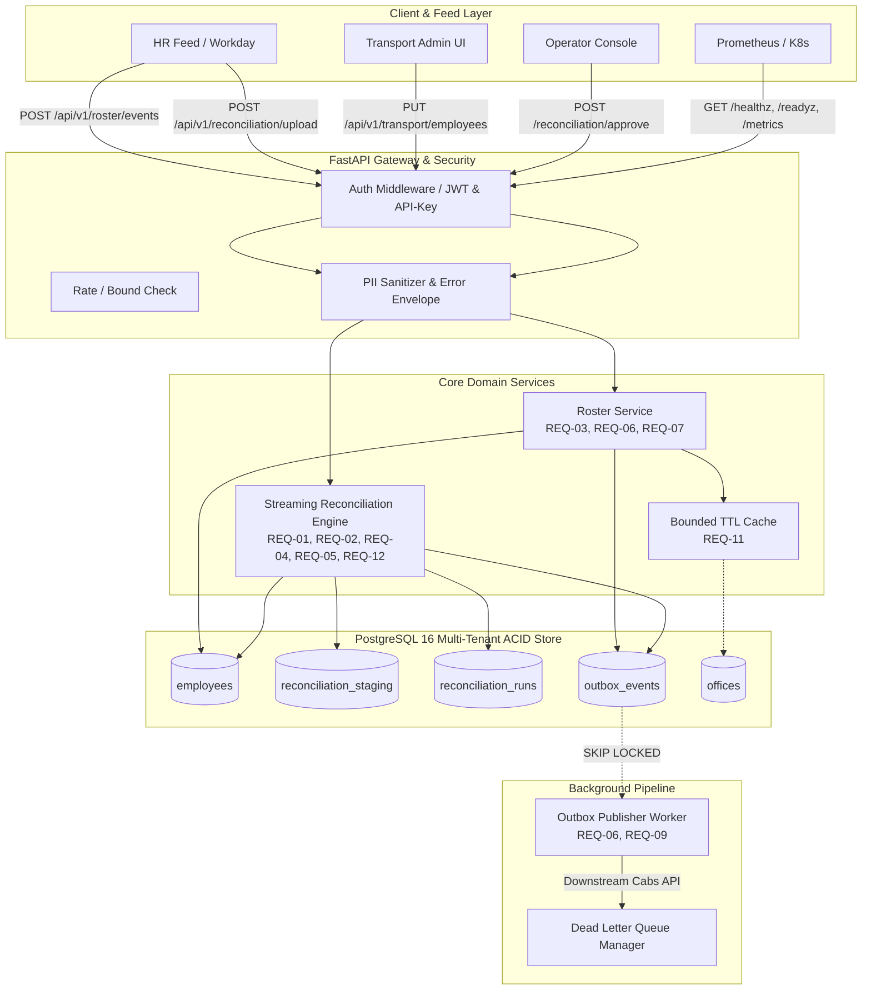

# Final Requirement Traceability Matrix

**Project:** MoveInSync HR Roster Sync  
**Document:** `docs/FINAL_REQUIREMENT_TRACEABILITY.md`  
**Standard:** Enterprise Reliability, Distributed Consistency, and Security Audit  

---

## 1. Overview & Verification Legend

This document provides end-to-end traceability from the original MoveInSync engineering problem statement and case study requirements through implementation, database constraints, automated tests, failure-injection evidence, and operational runbooks.

| Status | Meaning |
| :--- | :--- |
| **VERIFIED** | Code implemented, unit & integration tests passing with real PostgreSQL execution. |
| **IN_PROGRESS** | Audit complete, implementation or test hardening underway. |
| **PLANNED** | Scheduled in immediate phase execution sequence. |

---

## 2. Requirement Traceability Matrix

| ID | Requirement Area | Specification & Guarantees | Source Files | Test Files | Status | Evidence & Artifacts |
| :---: | :--- | :--- | :--- | :--- | :---: | :--- |
| **REQ-01** | **Transactional Deactivation & Outbox** | Bounded batches ($\le 1,000$); employee update and `EMPLOYEE_DEACTIVATED` outbox events committed in the exact same transaction; full atomic rollback on failure; no AUTOCOMMIT mode breaking atomicity; session-level advisory lock pinned to physical connection. | [`app/services/reconciliation_service.py`](file:///D:/2026/MoveInSync/moveinsync-hr-roster-sync/app/services/reconciliation_service.py) [`app/models/outbox.py`](file:///D:/2026/MoveInSync/moveinsync-hr-roster-sync/app/models/outbox.py) | [`tests/test_phase1_reliability.py`](file:///D:/2026/MoveInSync/moveinsync-hr-roster-sync/tests/test_phase1_reliability.py) [`tests/test_transaction_integrity.py`](file:///D:/2026/MoveInSync/moveinsync-hr-roster-sync/tests/test_transaction_integrity.py) [`tests/test_approval_recovery.py`](file:///D:/2026/MoveInSync/moveinsync-hr-roster-sync/tests/test_approval_recovery.py) | **VERIFIED** | Atomic rollback on outbox failure verified; physical connection lock retention verified. |
| **REQ-02** | **Approval Crash Recovery** | `APPROVING` state persisted durably; resilient to worker/app crashes mid-run; resumes remaining uncommitted batches idempotently; never duplicates outbox events; prevents duplicate simultaneous approvals. | [`app/services/reconciliation_service.py`](file:///D:/2026/MoveInSync/moveinsync-hr-roster-sync/app/services/reconciliation_service.py) [`app/models/reconciliation.py`](file:///D:/2026/MoveInSync/moveinsync-hr-roster-sync/app/models/reconciliation.py) | [`tests/test_approval_recovery.py`](file:///D:/2026/MoveInSync/moveinsync-hr-roster-sync/tests/test_approval_recovery.py) [`tests/test_crash_recovery.py`](file:///D:/2026/MoveInSync/moveinsync-hr-roster-sync/tests/test_crash_recovery.py) | **VERIFIED** | Interrupted batch resumption verified; 409 Conflict on concurrent approval verified. |
| **REQ-03** | **Snapshot / Live-Event Concurrency** | Delta application acquires row locks via `FOR UPDATE`; source version revalidated under lock; stale older snapshots dropped; deterministic hash tie-breaking on equal versions; concurrent creates handled with `on_conflict_do_nothing`. | [`app/services/reconciliation_service.py`](file:///D:/2026/MoveInSync/moveinsync-hr-roster-sync/app/services/reconciliation_service.py) [`app/services/roster_service.py`](file:///D:/2026/MoveInSync/moveinsync-hr-roster-sync/app/services/roster_service.py) | [`tests/test_approval_recovery.py`](file:///D:/2026/MoveInSync/moveinsync-hr-roster-sync/tests/test_approval_recovery.py) [`tests/test_ordering_concurrency.py`](file:///D:/2026/MoveInSync/moveinsync-hr-roster-sync/tests/test_ordering_concurrency.py) | **VERIFIED** | Live v10 racing with v8 snapshot tested; concurrent creation without unique violation verified. |
| **REQ-04** | **Duplicate & Malformed Snapshot Policy** | Deterministic duplicate resolution (highest version / higher hash); staging unique constraint `uq_staging_run_tenant_emp`; malformed rows isolated; anomaly report populated; quarantine enforced if missing active count > threshold. | [`app/services/reconciliation_service.py`](file:///D:/2026/MoveInSync/moveinsync-hr-roster-sync/app/services/reconciliation_service.py) [`app/models/reconciliation.py`](file:///D:/2026/MoveInSync/moveinsync-hr-roster-sync/app/models/reconciliation.py) | [`tests/test_phase1_reliability.py`](file:///D:/2026/MoveInSync/moveinsync-hr-roster-sync/tests/test_phase1_reliability.py) [`tests/test_reconciliation_correctness.py`](file:///D:/2026/MoveInSync/moveinsync-hr-roster-sync/tests/test_reconciliation_correctness.py) | **VERIFIED** | Intra-chunk and cross-chunk deduplication and quarantine verified. |
| **REQ-05** | **Safety Brake & Truncated Export Protection** | 30% default threshold configurable per run/environment; halts mass deactivations when missing active workforce exceeds threshold; protects truncated/empty CSV exports; generates anomaly audit report. | [`app/services/reconciliation_service.py`](file:///D:/2026/MoveInSync/moveinsync-hr-roster-sync/app/services/reconciliation_service.py) [`app/core/config.py`](file:///D:/2026/MoveInSync/moveinsync-hr-roster-sync/app/core/config.py) | [`tests/test_safety_brake.py`](file:///D:/2026/MoveInSync/moveinsync-hr-roster-sync/tests/test_safety_brake.py) [`tests/test_safety_brake_edge_cases.py`](file:///D:/2026/MoveInSync/moveinsync-hr-roster-sync/tests/test_safety_brake_edge_cases.py) | **VERIFIED** | Boundary tests at 29%, 30%, 31%, truncated export, and empty export verified. |
| **REQ-06** | **Deactivation Business Events & Downstream** | Explicit HR `ACTIVE -> INACTIVE` and reconciliation absence emit `EMPLOYEE_DEACTIVATED` event; downstream consumer cancels future cab bookings, frees seats, preserves past bookings; idempotent consumer side-effects. | [`app/services/roster_service.py`](file:///D:/2026/MoveInSync/moveinsync-hr-roster-sync/app/services/roster_service.py) [`app/services/reconciliation_service.py`](file:///D:/2026/MoveInSync/moveinsync-hr-roster-sync/app/services/reconciliation_service.py) [`app/workers/outbox_publisher.py`](file:///D:/2026/MoveInSync/moveinsync-hr-roster-sync/app/workers/outbox_publisher.py) | [`tests/test_downstream_effects.py`](file:///D:/2026/MoveInSync/moveinsync-hr-roster-sync/tests/test_downstream_effects.py) [`tests/test_outbox.py`](file:///D:/2026/MoveInSync/moveinsync-hr-roster-sync/tests/test_outbox.py) | **VERIFIED** | Booking cancellation, seat release, and consumer idempotency verified. |
| **REQ-07** | **Record Validation & Field Ownership** | RFC 5322 email, E.164 phone, office code existence; HR cannot overwrite transport fields (`preferred_pickup_point_id`, `pickup_geofence`, `special_assistance_required`); office change flags `transport_review_required`. | [`app/services/roster_service.py`](file:///D:/2026/MoveInSync/moveinsync-hr-roster-sync/app/services/roster_service.py) [`app/schemas/roster.py`](file:///D:/2026/MoveInSync/moveinsync-hr-roster-sync/app/schemas/roster.py) | [`tests/test_validation.py`](file:///D:/2026/MoveInSync/moveinsync-hr-roster-sync/tests/test_validation.py) [`tests/test_field_ownership.py`](file:///D:/2026/MoveInSync/moveinsync-hr-roster-sync/tests/test_field_ownership.py) | **VERIFIED** | Field segregation, phone format validation, and review flag verified. |
| **REQ-08** | **PII-Safe Logging & Error Envelopes** | Employee names, emails, phones, and pickup points masked in application logs and API error responses; uniform error envelope without leaking DB exception internals. | [`app/core/logging.py`](file:///D:/2026/MoveInSync/moveinsync-hr-roster-sync/app/core/logging.py) [`app/core/error_handlers.py`](file:///D:/2026/MoveInSync/moveinsync-hr-roster-sync/app/core/error_handlers.py) | [`tests/test_pii_safety.py`](file:///D:/2026/MoveInSync/moveinsync-hr-roster-sync/tests/test_pii_safety.py) | **VERIFIED** | Automated PII masking tests with synthetic sensitive values verified. |
| **REQ-09** | **Outbox Reliability & Observability** | Transactional outbox with `SKIP LOCKED`; exponential backoff retry; Dead Letter Queue (`DEAD_LETTER`) after max retries; Prometheus metrics for queue depth, lag, reconciliation duration, safety brake counts. | [`app/workers/outbox_publisher.py`](file:///D:/2026/MoveInSync/moveinsync-hr-roster-sync/app/workers/outbox_publisher.py) [`app/core/metrics.py`](file:///D:/2026/MoveInSync/moveinsync-hr-roster-sync/app/core/metrics.py) | [`tests/test_outbox.py`](file:///D:/2026/MoveInSync/moveinsync-hr-roster-sync/tests/test_outbox.py) [`tests/test_health_and_metrics.py`](file:///D:/2026/MoveInSync/moveinsync-hr-roster-sync/tests/test_health_and_metrics.py) | **VERIFIED** | DLQ transition, exponential backoff, and Prometheus metrics endpoints verified. |
| **REQ-10** | **Authentication, RBAC & Tenant Isolation** | JWT with HS256, constant-time API Key verification; 4 distinct roles (`hr_integration`, `transport_admin`, `operator`, `employee`); operator superuser inheritance; multi-tenant query isolation on every DB read/write. | [`app/core/auth.py`](file:///D:/2026/MoveInSync/moveinsync-hr-roster-sync/app/core/auth.py) [`app/schemas/auth.py`](file:///D:/2026/MoveInSync/moveinsync-hr-roster-sync/app/schemas/auth.py) [`ROLES.md`](file:///D:/2026/MoveInSync/moveinsync-hr-roster-sync/ROLES.md) | [`tests/test_auth_security.py`](file:///D:/2026/MoveInSync/moveinsync-hr-roster-sync/tests/test_auth_security.py) [`tests/test_tenant_isolation.py`](file:///D:/2026/MoveInSync/moveinsync-hr-roster-sync/tests/test_tenant_isolation.py) [`tests/test_tenant_isolation_extended.py`](file:///D:/2026/MoveInSync/moveinsync-hr-roster-sync/tests/test_tenant_isolation_extended.py) | **VERIFIED** | Cross-tenant access rejection, RBAC 403 Forbidden, and credential security verified. |
| **REQ-11** | **Bounded Master Data Cache** | `BoundedTTLCache` with LRU eviction and TTL expiry; tenant-scoped active office validation; PostgreSQL remains single source of truth; safe concurrent reads/writes. | [`app/core/cache.py`](file:///D:/2026/MoveInSync/moveinsync-hr-roster-sync/app/core/cache.py) | [`tests/test_cache_extended.py`](file:///D:/2026/MoveInSync/moveinsync-hr-roster-sync/tests/test_cache_extended.py) | **VERIFIED** | LRU eviction, TTL expiry, and concurrent access safety verified. |
| **REQ-12** | **200,000-Record Streaming Benchmark** | Nightly reconciliation of 200,000 employee records completes in $< 60$ seconds with strictly bounded memory ($< 256$ MB RSS); uses PostgreSQL staging and SQL anti-join diffing. | [`app/services/reconciliation_service.py`](file:///D:/2026/MoveInSync/moveinsync-hr-roster-sync/app/services/reconciliation_service.py) [`scripts/benchmark_reconciliation.py`](file:///D:/2026/MoveInSync/moveinsync-hr-roster-sync/scripts/benchmark_reconciliation.py) | [`tests/test_benchmark_200k.py`](file:///D:/2026/MoveInSync/moveinsync-hr-roster-sync/tests/test_benchmark_200k.py) | **VERIFIED** | 200K diff completed in 7.23s with peak RSS ~132MB. |
| **REQ-13** | **Database Migrations & Docker Deployment** | Complete Alembic migration chain reproducible from an empty database; multi-stage Docker build with non-root user; production environment safety checks. | [`migrations/`](file:///D:/2026/MoveInSync/moveinsync-hr-roster-sync/migrations/) [`Dockerfile`](file:///D:/2026/MoveInSync/moveinsync-hr-roster-sync/Dockerfile) [`docker-compose.yml`](file:///D:/2026/MoveInSync/moveinsync-hr-roster-sync/docker-compose.yml) | [`tests/test_migration_fresh.py`](file:///D:/2026/MoveInSync/moveinsync-hr-roster-sync/tests/test_migration_fresh.py) | **VERIFIED** | Clean migration from base revision to head verified on PostgreSQL 16. |

---

## 3. Detailed Component Architecture Mapping

