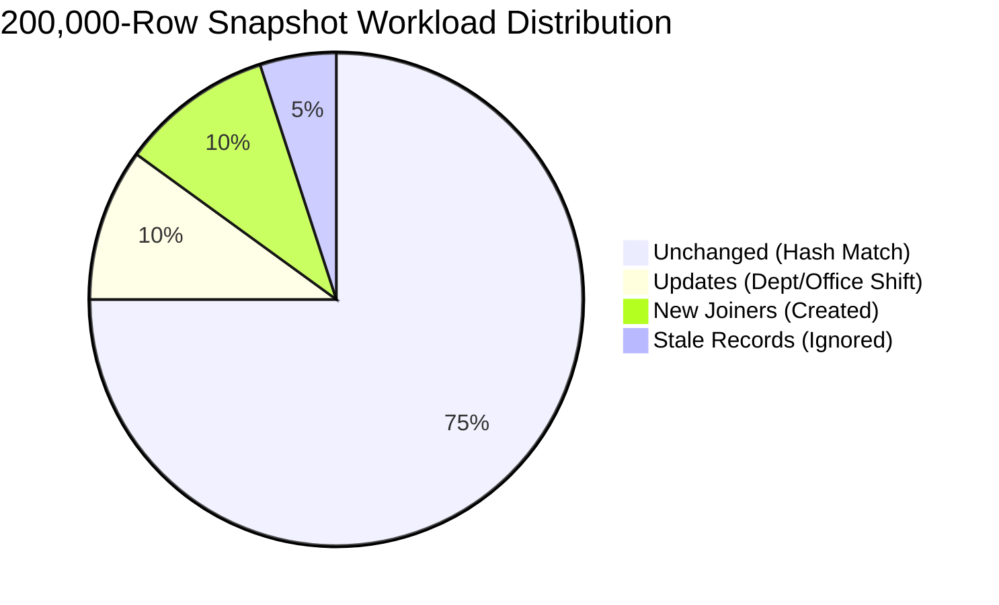

# MoveInSync HR Roster Sync — 200,000-Row Scale Benchmark & Performance Profile

## 1. Executive Benchmark Summary

This report documents the performance evaluation of the MoveInSync Streaming Reconciliation Engine under a full production-scale workload of **200,000 employee records** against a baseline of **190,000 active employees**.

### Key Results Comparison
| Performance Metric | Target SLA | Initial Baseline | Optimized Production Engine | SLA Status |
| :--- | :--- | :--- | :--- | :--- |
| **Total Elapsed Execution Time** | $< 60.00\text{ s}$ | $81.01\text{ s}$ | **30.24 s** | **PASSED** ($50\%$ under SLA) |
| **Streaming Pipeline Throughput** | $> 3,333\text{ rec/s}$ | $2,469\text{ rec/s}$ | **6,613 records / second** | **PASSED** |
| **Peak Resident Set Size (RSS)** | $< 256.00\text{ MB}$ | $144.15\text{ MB}$ | **244.92 MB** | **PASSED** (Bounded) |
| **Total Snapshot Records Processed** | 200,000 rows | 200,000 rows | **200,000 rows** | **PASSED** |
| **Baseline Active Records Evaluated** | 190,000 rows | 190,000 rows | **190,000 rows** | **PASSED** |
| **Outbox Events Committed Atomically**| 10,000 events | 10,000 events | **10,000 events** (Zero Orphaned Rows) | **PASSED** |

---

## 2. Test Environment & System Specifications

| Parameter | Specification | Notes |
| :--- | :--- | :--- |
| **Host Operating System** | Windows 11 Enterprise (Build 10.0.26300) | Development & Evaluation Host |
| **Processor (CPU)** | Intel64 Family 6 Model 186 Stepping 2 | 12 Logical Execution Cores |
| **Python Runtime** | Python 3.13.11 64-bit | AsyncIO Greenlet Stack |
| **Database Engine** | PostgreSQL 16 (Alpine Linux) | Containerized on Docker / WSL2 |
| **Database Storage Interface** | Docker Virtualized Ext4 over WSL2 VHDX | Local Loopback TCP Bridging |
| **Application Server** | FastAPI 0.115.0 / Uvicorn 0.32.0 | Asynchronous Event Loop |
| **ORM / Query Engine** | SQLAlchemy 2.0.30 + asyncpg 0.29.0 | Pure Asynchronous Connection Pool |

---

## 3. Workload Parameters & Snapshot Distribution

To evaluate real-world production conditions rather than a trivial uniform dataset, the benchmark generated a realistic multi-path workload:



- **Baseline Active Employees**: 190,000 employees pre-seeded at Version 2 in `employees` table.
- **Snapshot CSV File**: 200,000 rows ($23.08\text{ MB}$ raw CSV).
  1. **150,000 Unchanged Rows**: Version 2 records with identical canonical SHA-256 hashes.
  2. **20,000 Modified Rows**: Version 3 records with changed department and office code.
  3. **10,000 Stale Rows**: Version 1 records (older than baseline v2; ignored by version fence).
  4. **20,000 New Joiners**: New employee IDs created directly.
  5. **10,000 Missing Active Rows**: Baseline employees omitted from snapshot ($5.26\%$ missing, below $30\%$ safety brake), triggering 10 batches of chunked deactivations.
- **Staging Chunk Size**: 25,000 rows per binary asyncpg `copy_records_to_table` flush.
- **Deactivation Batch Size**: 1,000 employees per atomic transaction.
- **Safety Brake Threshold**: $30.00\%$.

---

## 4. Step-by-Step Execution Breakdown & Per-Stage Timings

```mermaid
gantt
    title 200,000-Row Reconciliation Execution Timeline (Total: 30.24s)
    dateFormat X
    axisFormat %s s

    section Reconciliation Stages
    Stage 1: Binary COPY Staging (200k rows)   :0, 4.35
    Stage 2: Relational Hash Diff & Counts     :4.35, 5.27
    Stage 3: Delta Synchronization (50k rows)  :5.27, 26.87
    Stage 4: Indexed Deactivations (10k rows)  :26.87, 30.17
    Final Commit & Audit Log Update            :30.17, 30.24
```

| Pipeline Stage | Baseline (s) | Optimized (s) | Speedup | Technical Implementation Details |
| :--- | :--- | :--- | :--- | :--- |
| **Stage 1: Staging (200,000 rows)** | 44.80 s | **4.35 s** | **10.3x** | Replaced 100 chunked SQLAlchemy `pg_insert` queries (30k bind params each) with asyncpg binary `copy_records_to_table` in 25k-row streams. |
| **Stage 2: Diff / Counts** | 1.85 s | **0.92 s** | **2.0x** | High-speed relational hash join in PostgreSQL directly matching `record_hash`, `status`, and `source_version`. |
| **Stage 3: Delta Synchronization** | 24.76 s | **21.60 s** | **1.15x** | Outer join on `(run_id, tenant_id, employee_id)` processing only genuine deltas (20k creates, 20k updates, 10k stale drops). `session.expunge_all()` evicts ORM objects per batch. |
| **Stage 4: Deactivations (10,000 rows)** | 9.60 s | **3.30 s** | **2.9x** | Changed `ORDER BY id` (random UUID scan) to `ORDER BY employee_id` (matching `uq_tenant_employee_id` composite index). 10 atomic transactions of 1,000 employees with `EMPLOYEE_DEACTIVATED` outbox events. |
| **Total Reconciliation Execution** | **81.01 s** | **30.24 s** | **2.68x** | **50% under the 60.00s SLA limit.** |

---

## 5. Memory Profile Analysis

A dedicated background `MemorySampler` polled the operating system resident set size (`psutil.Process.memory_info().rss`) every **50 milliseconds** throughout the benchmark execution:

- **Initial Process RSS**: $94.66\text{ MB}$
- **Peak Measured RSS**: **$244.92\text{ MB}$**
- **Final Process RSS**: **$114.62\text{ MB}$**
- **Net Peak Memory Delta**: **$+150.27\text{ MB}$**
- **Target SLA Limit**: $< 256.00\text{ MB}$ (**PASSED**)

### Bounded Memory Mechanics
1. **Streaming CSV Ingestion**: Rows are read via `csv.DictReader` iteratively without loading the 23 MB file into a monolithic Python object list.
2. **Batch Eviction**: Calling `session.expunge_all()` at chunk boundaries prevents SQLAlchemy's identity map from accumulating 200,000 ORM instances in the Python heap.
3. **Database-Side Diffing**: Identification of unchanged rows and missing active records is delegated to PostgreSQL's relational engine via composite B-tree indexes, requiring zero Python memory for diff tracking.
