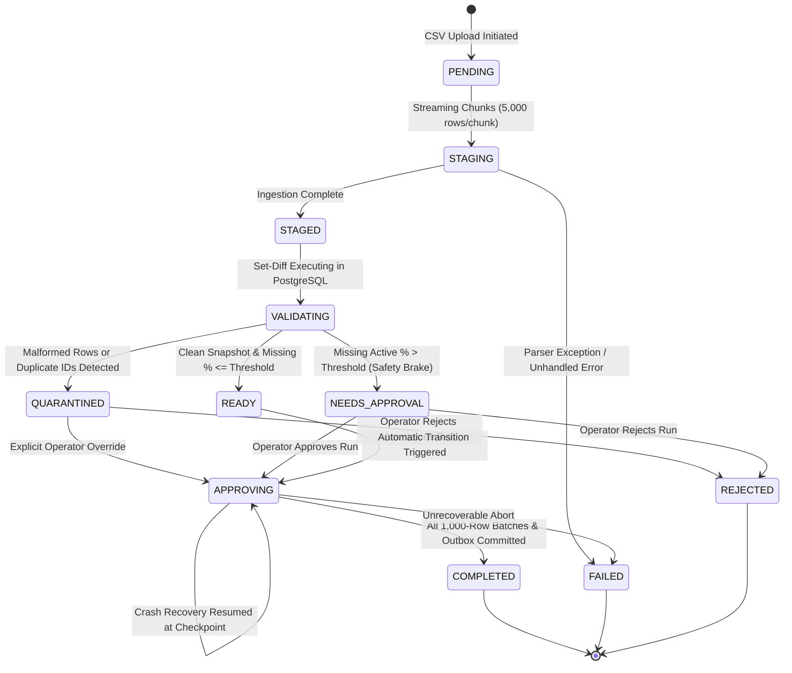
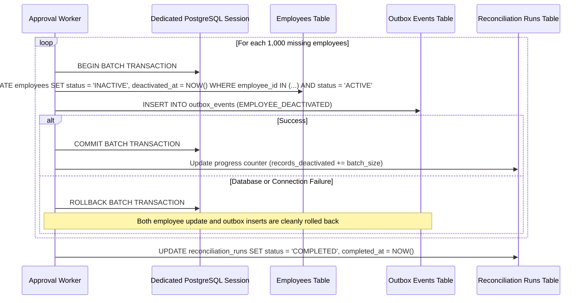

# MoveInSync HR Roster Sync — Reconciliation Lifecycle & Safety Mechanics

## 1. Complete Reconciliation Lifecycle State Machine

The reconciliation process coordinates the transition from raw, untrusted CSV snapshot exports to verified, atomically committed employee roster states. Every run is tracked in `reconciliation_runs` through a deterministic, crash-safe state machine:



---

## 2. Ingestion & Streaming Staging Mechanics

To support arbitrary snapshot sizes (up to 200,000+ rows) without violating the `< 256 MB` RSS memory constraint, the ingestion pipeline streams CSV input line-by-line rather than buffering the entire file into memory:

### A. DictReader Normalization & Header Cleansing
Upstream HRIS systems frequently export CSVs with byte-order marks (UTF-8 BOM), trailing whitespace, or inconsistent case conventions. The ingress reader standardizes every row key:
```python
clean_key = raw_key.strip().lstrip("\ufeff").lower().replace(" ", "_")
```

### B. Separate Counter Accounting
The system tracks separate, unambiguous metric counters:
1. `raw_rows`: Total number of physical lines scanned in the CSV.
2. `valid_rows`: Syntactically correct rows staged successfully.
3. `malformed_rows`: Rows failing schema, email, phone, or field length constraints.
4. `duplicate_rows`: Rows presenting an `employee_id` already encountered in the current run.

### C. Cross-Chunk Duplicate Detection
A naive in-memory set cannot scale to 200,000 IDs without unbounded heap growth. Cross-chunk duplicate detection is enforced at the database level:
- In `reconciliation_staging`, a composite unique constraint is defined:
  ```sql
  CONSTRAINT uq_staging_run_employee UNIQUE (run_id, employee_id)
  ```
- Any duplicate ID across chunk boundaries triggers a uniqueness violation or is caught during pre-flight staging validation, transitioning the run immediately to `QUARANTINED`.

---

## 3. The 30% Safety Brake

The **Safety Brake** is an essential operational defense mechanism designed to prevent catastrophic mass-deactivations caused by faulty upstream HR exports (e.g., departmental export filters applied erroneously by HR staff).

### A. Mathematical Formula
$$\text{Missing Percentage} = \left( \frac{\text{Missing Active Employees}}{\text{Baseline Active Employees}} \right) \times 100$$

Where:
- $\text{Baseline Active Employees}$: Total employees in `employees` table with `tenant_id = :tenant_id AND status = 'ACTIVE'`.
- $\text{Missing Active Employees}$: Active employees present in the baseline but completely absent from the current snapshot export.

### B. Exact Threshold Boundary Semantics
By default, the safety brake threshold is set to **30.00%**:

| Missing Active Ratio | Evaluated Condition | Resulting State | Automated Action |
| :--- | :--- | :--- | :--- |
| **29.99%** | $\le 30.00\%$ | `READY` $\rightarrow$ `APPROVING` | Automatically deactivates missing employees; commits outbox. |
| **30.00%** | $\le 30.00\%$ | `READY` $\rightarrow$ `APPROVING` | Exact boundary condition: Auto-approves and executes deactivations. |
| **30.01%** | $> 30.00\%$ | `NEEDS_APPROVAL` | **Safety Brake Tripped**: Automatic deactivations HALTED immediately. |

### C. Zero Baseline Guard
If the baseline employee count is zero (e.g., initial tenant bootstrap), the safety brake evaluates to `0.00%`, allowing new joiner creation without tripping an artificial division-by-zero error.

---

## 4. Snapshot Quarantine Policy

A snapshot is deemed **unreliable** and unsafe for automated destructive actions if it contains data anomalies:

### Quarantine Triggers
1. **Malformed Rows**: Any row with unparseable fields, invalid email format, invalid phone formatting, or missing mandatory identity tokens.
2. **Duplicate Employee IDs**: Multiple records in the same CSV claiming the same `employee_id`.

### Policy Enforcement
- When `malformed_rows_count > 0` or `duplicate_rows_count > 0`, the reconciliation engine **never executes automatic deactivations**.
- The run transitions to `QUARANTINED`.
- The exact row numbers and anomaly descriptions are persisted in `reconciliation_runs.quarantine_reason`.
- Destructive deactivation is blocked until an authenticated operator explicitly inspects the anomalies and submits `POST /api/v1/reconciliation/runs/{run_id}/approve`.

---

## 5. Chunked Deactivation & Transactional Outbox Batching

When a reconciliation run is approved (automatically or via operator action), deactivations are applied using **bounded, atomic batches of 1,000 employees**:



### Key Correctness Guarantees
1. **No Orphaned Deactivations**: Updating an employee to `INACTIVE` and inserting their `EMPLOYEE_DEACTIVATED` event occur in the **exact same PostgreSQL transaction**. If outbox insertion fails, the employee status rollback is guaranteed.
2. **Never Materialize All Missing IDs**: Deactivations stream in batches of 1,000 using cursor or chunked pagination; all 10,000+ IDs are never loaded into Python heap simultaneously.
3. **Transition Verification**: Outbox events are emitted **only** for actual `ACTIVE -> INACTIVE` transitions. If an employee was already `INACTIVE`, no redundant event is generated.

---

## 6. Crash Recovery & Re-Approval Protection

### A. Crash Recovery Protocol
If an approval worker process crashes mid-run (e.g., node restart, OOM kill, hardware failure):
1. Committed batches of 1,000 remain durable in PostgreSQL.
2. The run remains in `APPROVING` status.
3. When the service restarts, or an operator triggers approval again:
   - The engine acquires the session-level advisory lock `pg_try_advisory_lock(hash(run_id))`.
   - The query searches for remaining active missing employees:
     ```sql
     WHERE e.status = 'ACTIVE' AND s.employee_id IS NULL
     ```
   - Already-deactivated employees are automatically excluded from subsequent batches.
   - Processing resumes seamlessly without duplicate outbox events or repeated mutations.

### B. Re-Approval & Duplicate Prevention
- If an operator attempts to approve a run that is already `COMPLETED`:
  - Returns `400 Bad Request` or `409 Conflict`: "Run is already COMPLETED".
- If a second operator or background thread attempts to approve a run concurrently:
  - The session-level advisory lock rejects the concurrent request with `409 Conflict`: "Approval already in progress by another worker".
  - Zero duplicate side-effects can ever occur.
