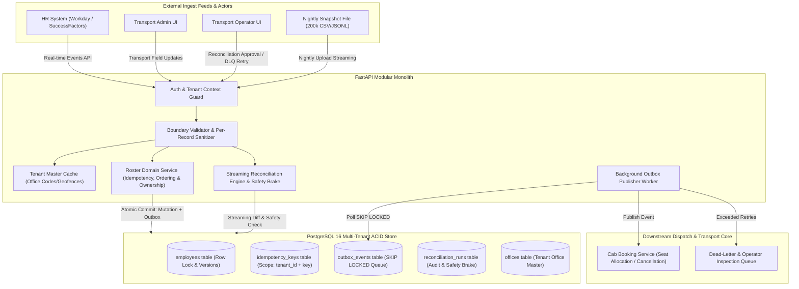
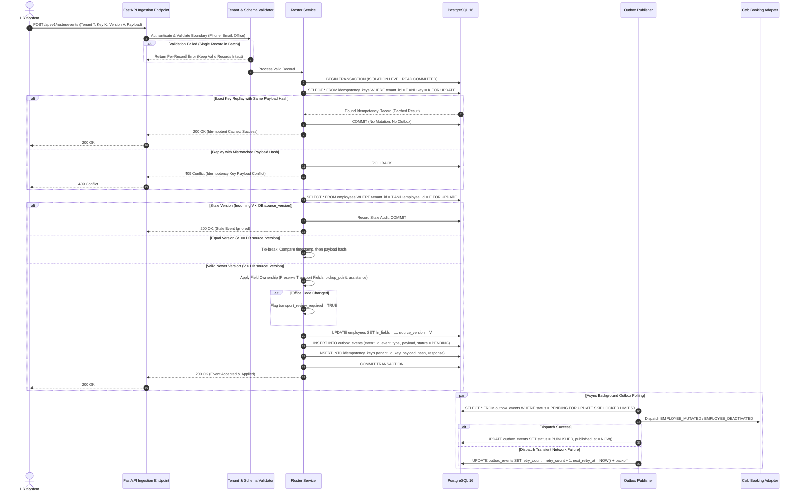
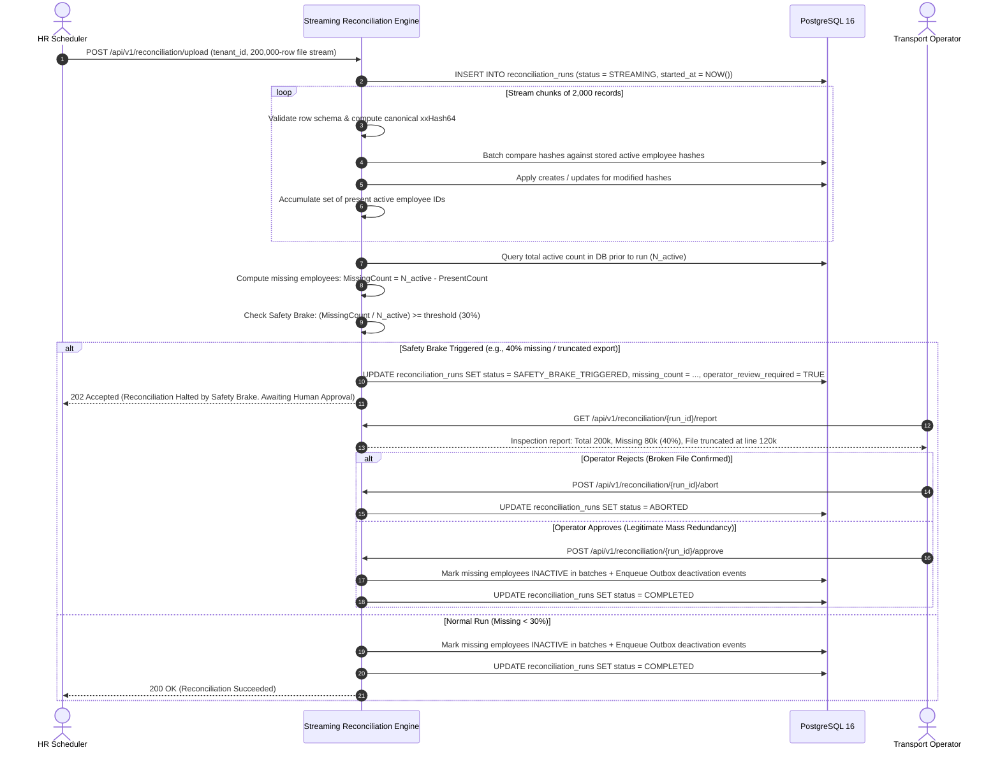
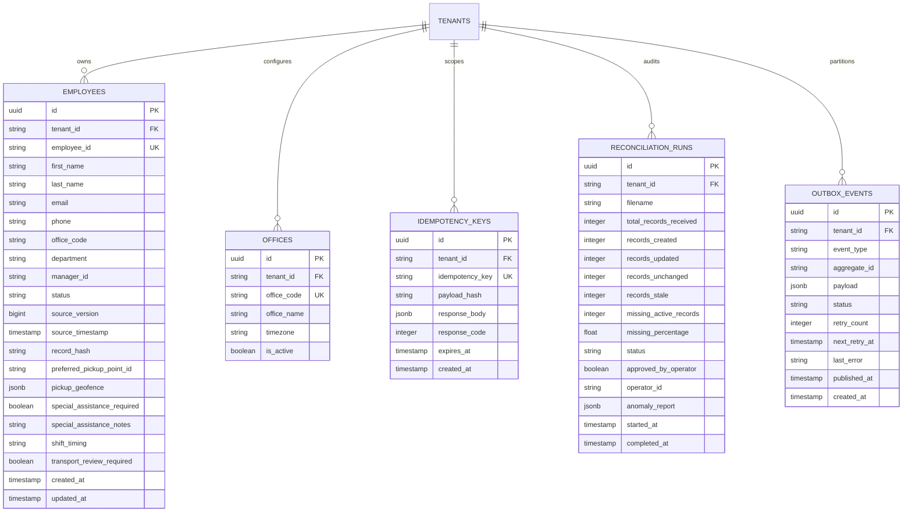

# MoveInSync Case Study 5: HR Roster Sync
## System Architecture & Technical Design Document

### 1. Architectural Overview & Component Topology
The HR Roster Sync system is engineered as a resilient, multi-tenant modular monolith. It decouples high-throughput ingest from transactional mutations and downstream event delivery via the **Transactional Outbox Pattern**.

---

### 2. Sequence Diagrams

#### A. Event Ingestion, Idempotency & Outbox Publication

#### B. Nightly Reconciliation & Safety Brake Protocol

---

### 3. Data Model & PostgreSQL Schema Design

#### Key Indexes & Constraints
1. `idx_employees_tenant_emp_id`: UNIQUE `(tenant_id, employee_id)` — Guarantees multi-tenant employee identity.
2. `idx_employees_tenant_version`: `(tenant_id, employee_id, source_version)` — Fast conditional version checks.
3. `idx_idempotency_tenant_key`: UNIQUE `(tenant_id, idempotency_key)` — Scopes idempotency strictly to tenant.
4. `idx_outbox_pending_poll`: `(status, next_retry_at)` WHERE `status IN ('PENDING', 'RETRYING')` — Partial index optimizing `SKIP LOCKED` polling without scanning millions of historical published rows.
5. `idx_employees_tenant_status_hash`: `(tenant_id, status, record_hash)` — Fast hash matching during reconciliation diffing.

---

### 4. Failure Modes & Recovery Matrix

| Failure Mode | Direct Symptom | Root Cause | System Detection & Mitigation | User / Client Impact |
| :--- | :--- | :--- | :--- | :--- |
| **Out-of-Order Events** | Transfer (v7) arrives before Shift Change (v6). | Network routing latency / multi-queue races. | Engine compares `source_version`. Version 6 is lower than current 7. Event is recorded as stale audit log and ignored. | HTTP 200 returned with `{status: "stale_ignored"}`. No state regression. |
| **Identical Duplicate Event** | Exact same webhook posted multiple times. | Network retries / timeout replays. | Idempotency layer detects existing `(tenant_id, key)` with matching hash. | HTTP 200 returns cached original response. Zero side effects or duplicate outbox events. |
| **Conflicting Idempotency Replay** | Same key used with differing employee data. | Client bug reusing keys across distinct operations. | SHA-256 payload hash does not match stored hash for key. | HTTP 409 Conflict with detailed error: `Idempotency key reused with different payload`. |
| **Crash After DB Commit Before Outbox Publish** | Database has updated employee; HTTP response returned; process crashes before downstream dispatch. | Power failure, container OOM, VM reboot. | Transactional outbox commits event with employee update in same DB transaction. Background worker resumes on restart, claims unpublished row via `SKIP LOCKED`, and delivers it. | Zero event loss. Downstream system receives event with at-least-once guarantee. |
| **Downstream Cab Service Outage** | Cab booking cancellation fails with 503 or socket timeout. | Cab booking microservice down or network partition. | Outbox worker intercepts exception, applies exponential backoff ($2^r \times 1\text{s} + \text{jitter}$), increments `retry_count`. If max retries (5) exceeded, moves to `DEAD_LETTER`. | Core roster remains consistent. Operator alerted to inspect DLQ and trigger redelivery. |
| **Truncated Nightly File** | HR export cut off at 120,000 of 200,000 employees. | FTP connection dropped prematurely; disk space exhaustion at HR. | Safety brake computes 80,000 missing active employees (40% $> 30%$ threshold). Halts deactivation pass, creates operator incident. | 80,000 employees keep their cab bookings. Operator receives alert to investigate truncated file. |
| **Office Transfer Desync** | Employee moved from BLR-Campus-1 to HYD-Campus-2, but pickup point still in Bangalore. | Transport admin pickup routing is campus-specific. | Field ownership preserves transport fields but sets `transport_review_required = TRUE` and logs warning for transport planner. | Commute routing engine halts routing to old geofence and notifies transport planner to assign new pickup point. |
| **Cross-Tenant Attack Attempt** | Tenant A passes employee ID belonging to Tenant B in payload or URL. | Malicious actor or misconfigured API key. | JWT/API-key sets request tenant context. All queries enforce `WHERE tenant_id = context.tenant_id`. | HTTP 404 / 403. Tenant A cannot view or alter Tenant B data. |

---

### 5. Architectural Trade-offs & Consistency Decisions

1. **Transactional Outbox vs Distributed 2PC (Two-Phase Commit)**:
   - *Decision*: Adopted Transactional Outbox.
   - *Rationale*: Two-Phase Commit / XA transactions introduce tight coupling, severe latency, and deadlock vulnerability under high ingest volume. Outbox provides local ACID atomicity with asynchronous eventual consistency for downstream cab cancellations.
2. **At-Least-Once Delivery vs Exactly-Once Fallacy**:
   - *Decision*: Guaranteed at-least-once delivery with mandatory idempotent downstream consumer adapters.
   - *Rationale*: Distributed systems theory proves network partitions prevent true exactly-once side-effects across independent HTTP services. Making consumers idempotent (e.g. `cancel_booking(emp_id, event_id)`) guarantees safety.
3. **Streaming Memory Diff vs Loading Full 200k Records**:
   - *Decision*: Chunked streaming iteration with canonical 64-bit integer hashes.
   - *Rationale*: Loading 200,000 Python ORM objects consumes $> 1.2\text{ GB}$ RAM and causes intense garbage collection pauses. Streaming chunks of 2,000 records with scalar hashes keeps memory strictly bounded under 120MB RSS while executing diff in $< 45$ seconds.
4. **Deliberately Excluded Technologies**:
   - *Kafka / RabbitMQ*: PostgreSQL `SKIP LOCKED` provides guaranteed transactional atomicity with the primary database. Introducing a broker adds dual-write consistency hazards, deployment complexity, and operations overhead without adding throughput benefit at 200k nightly events.
   - *Redis*: Local bounded LRU cache with TTL handles office code master data cleanly without network hop latency or cache-invalidation race conditions.

---

### 6. API Surface Specification

| Method | Endpoint | Allowed Roles | Description |
| :--- | :--- | :--- | :--- |
| `POST` | `/api/v1/roster/events` | `hr_integration`, `operator` | Real-time batch/single HR event ingestion with per-record validation. |
| `POST` | `/api/v1/transport/employees/{id}` | `transport_admin`, `operator` | Transport admin update for pickup point and special assistance. |
| `GET` | `/api/v1/employees/{id}` | `employee`, `transport_admin`, `operator` | Retrieve employee profile (scoped by tenant and role). |
| `POST` | `/api/v1/reconciliation/upload` | `hr_integration`, `operator` | Stream full nightly export file (CSV/JSONL up to 200k rows). |
| `GET` | `/api/v1/reconciliation/{run_id}` | `hr_integration`, `transport_admin`, `operator` | Query status, metrics, and safety brake report for a reconciliation run. |
| `POST` | `/api/v1/reconciliation/{run_id}/approve` | `operator` | Operator approval to override safety brake and execute deactivations. |
| `POST` | `/api/v1/reconciliation/{run_id}/abort` | `operator` | Operator abort of halted reconciliation run. |
| `GET` | `/api/v1/outbox/dlq` | `operator` | Inspect failed outbox events in dead-letter state. |
| `POST` | `/api/v1/outbox/dlq/{id}/retry` | `operator` | Re-enqueue a failed outbox event for immediate retry. |
| `GET` | `/healthz` | Public | Liveness probe (HTTP 200). |
| `GET` | `/readyz` | Public | Readiness probe (validates PostgreSQL connectivity). |
| `GET` | `/metrics` | Public / Prometheus | Prometheus metrics endpoint. |
